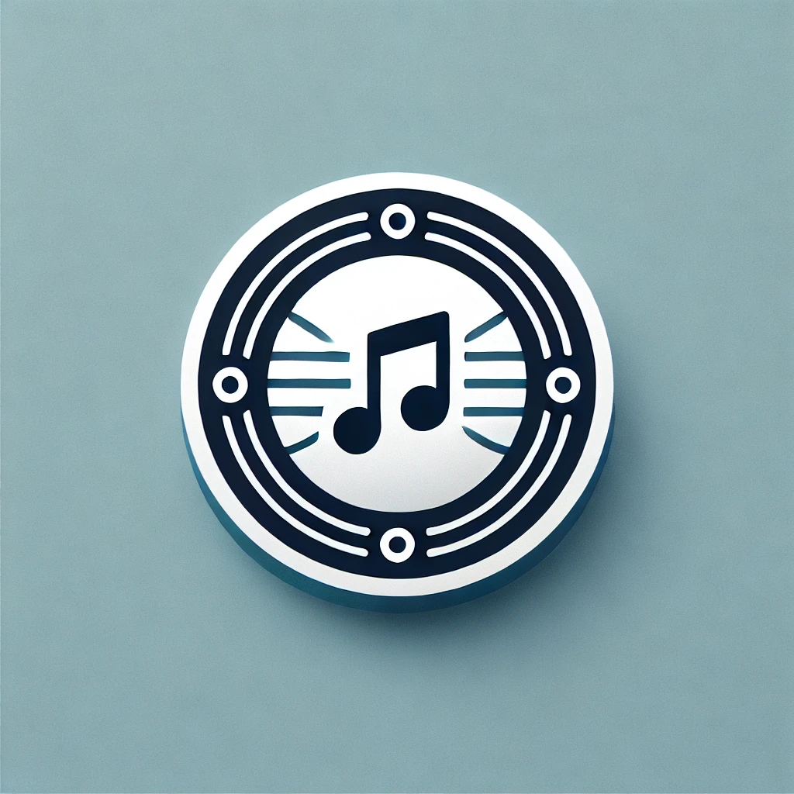
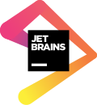

# Naviseerr - self-hosted music manager

<p align="center">
    
</p>

## Introduction

### Logging

To enable debug logging, change `INFO` following line in `application.yml` to either `DEBUG` or `TRACE`:

```yml
    com.github.schaka: INFO
```

### What's going on here? Is this a usable project?

Right now, it's not. There are some plans to combine a bunch of simple scripts into one more usable apps.
The initial inspiration was Overseerr, Navidrome (hence the name), Lidarr, Lidify, Soularr and slsdk.

So far, it can only download your Lidarr "Wanted" list via Slskd. Matching is still inconsistent and functionality like retries on error'd downloads haven't been implemented yet.
However, matching is in a state usable enough to start out populating your library.

### Stance on AI usage

I am not against the use of GenAI as a whole. However, all code needs to be reviewed, understood (and adjusted) by humans.
Any PR opened by an AI agent or user without any manual oversight will be automaticaly closed without further comment. 

PRs may also not be summarized by an AI. The entire text explaining what they intend to do needs to be written by a human. The only exception is using a translation tool for submitters who don't feel confident in their English skills.

The general guideline should be to only use LLMs as a rubber duck and discuss more architectural solutions and prototyping.
The code it generates is generally not good enough to pass review unless explicitly guided by a knowledgeable developer and contained to a few classes at most.


### Setup

Naviseerr requires Navidrome, Lidarr (nightly), slskd, and the naviseerr-tagging sidecar to be running.
The tagging service handles audio fingerprinting and metadata tagging via OneTagger and AcoustID.
Configuration is provided via a mounted `application.yml`.

See [docs/setup.md](docs/setup.md) for a full docker-compose example and step-by-step instructions.

### Local Development

The project includes a `LocalNaviseerrStarter` that spins up all dependencies automatically via
Testcontainers — no manual service configuration needed. Lidarr, slskd, Navidrome, PostgreSQL,
and the tagging service all start and configure themselves before Spring Boot boots.

Note that slskd connects to the real Soulseek network, so actual music downloads may occur.

See [docs/local_development.md](docs/local_development.md) for full instructions.

### So what's the roadmap?

#### For 1.0
- [x] Users duplicated from Navidrome, or if possible direct authentication against Navidrome
- [x] Pull listening activity from Navidrome per user
- [ ] ...and populate with additional metadata from LastFM and Spotify
- [ ] **Require** Lidarr with Plugins, so Tubifarry/Slskd implementation can be assumed
- [ ] Allow for requests directly to Lidarr, store all requests - validate against library availability in Navidrome, similar to Seerr
- [ ] Orchestrate tagging downloads with metadata, if they were pulled in via Usenet or Slskd downloads
- [ ] build out different recommendations via Listenbrainz, LastFM, Audiomuse-AI
- [ ] add user-triggerable jobs to generate playlists based on charts, Audiomuse, etc

### For 2.0
- support Jellyfin as a replacement for Navidrome
- Pull playlists from Spotify and YT Music
- Add support to pull recommendations from OpenAI compatible API (with tool calling)
- Octofiesta as backup for slskd


## JetBrains
Thank you to [ JetBrains](http://www.jetbrains.com/) for providing us with free licenses to their great tools.

* [ IntelliJ Idea](https://www.jetbrains.com/idea/)
* [ WebStorm](http://www.jetbrains.com/webstorm/)
* [ Rider](http://www.jetbrains.com/rider/)
